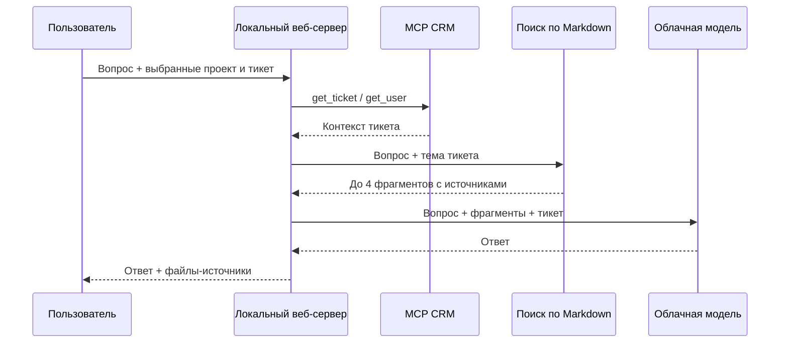

# Архитектура

## Компоненты

1. `src/server.js` — локальный HTTP-сервер: отдаёт лендинг и API чата. По умолчанию привязан к `127.0.0.1`.
2. `src/projects.js` — читает один проект из `projects/<id>/`. ID проверяется регулярным выражением, чтобы пути запроса не выходили из каталога проектов.
3. `src/retrieval.js` — делит Markdown выбранного продукта и документацию самого агента на разделы по заголовкам и ранжирует их локальным BM25-подобным поиском. Это retrieval-часть RAG; эмбеддинги в текущей версии не используются.
4. `src/mcp-server.js` — отдельный stdio MCP-сервер, предоставляющий чтение проектов, тикетов и пользователей из JSON.
5. `src/mcp-client.js` — MCP-клиент веб-сервера. Он запускает MCP-сервер дочерним процессом и использует `callTool` для контекста тикета.
6. `src/answer.js` — собирает найденные разделы, тикет, пользователя и последние реплики. При наличии ключа отправляет ограниченный контекст в OpenAI-совместимый `chat/completions`; без ключа показывает найденные выдержки.
7. `public/` — лендинг и чат. Секретов, прямого доступа к JSON и прямых запросов к облачной модели здесь нет.

## Поток ответа

Если `CLOUD_API_KEY` пуст, шаг с моделью пропускается, а пользователь видит найденные выдержки. Документы и JSON перечитываются на каждом запросе. Индекс в файл не записывается; это подходит для небольших баз знаний и позволяет быстро обновлять демо-проект. Для больших баз будущая версия может добавить кэш и эмбеддинги.

## Границы проекта

Агент не читает Obsidian-хранилище, не меняет тикеты и не действует от имени пользователя. Демо Invest Manager — независимый набор публичной документации и синтетических обращений. Интеграция с реальной CRM потребует отдельного адаптера MCP и модели прав доступа.
