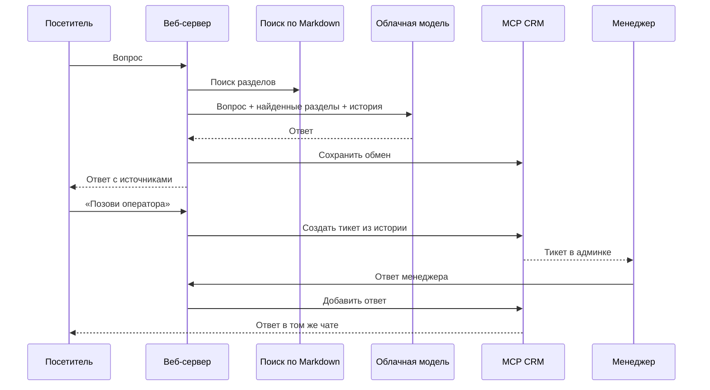

# Архитектура

## Два интерфейса

- `/` — публичный лендинг и чат. Посетитель видит только свою беседу по случайному идентификатору в HttpOnly-cookie; чужие тикеты не перечисляются.
- `/admin` — рабочее место менеджера. Доступ к API обращений требует пароля `ADMIN_PASSWORD` и отдельной HttpOnly-сессии.

## Компоненты

1. `src/server.js` — локальный HTTP-сервер, маршруты пользовательского и менеджерского API, проверка сессий.
2. `src/retrieval.js` — локальное BM25-подобное ранжирование разделов Markdown. Эмбеддинги пока не используются.
3. `src/answer.js` — формирование ответа через OpenAI-совместимый облачный API на основе найденных разделов и последних сообщений.
4. `src/mcp-server.js` и `src/mcp-client.js` — отдельный stdio MCP-сервер и его клиент в веб-сервере.
5. `src/store.js` — локальный JSON в `var/<project-id>.json`: посетительские сессии, тикеты, сообщения и статусы. Записи сериализованы по проекту и атомарно переименовываются.
6. `public/` — лендинг, чат, админка. В браузер не отправляются ключ модели и пароль менеджера.

## Поток

Запрос обычного вопроса не создаёт тикет. После передачи оператору новые сообщения пользователя идут в тикет без вызова модели. После закрытия агент снова принимает вопросы.
